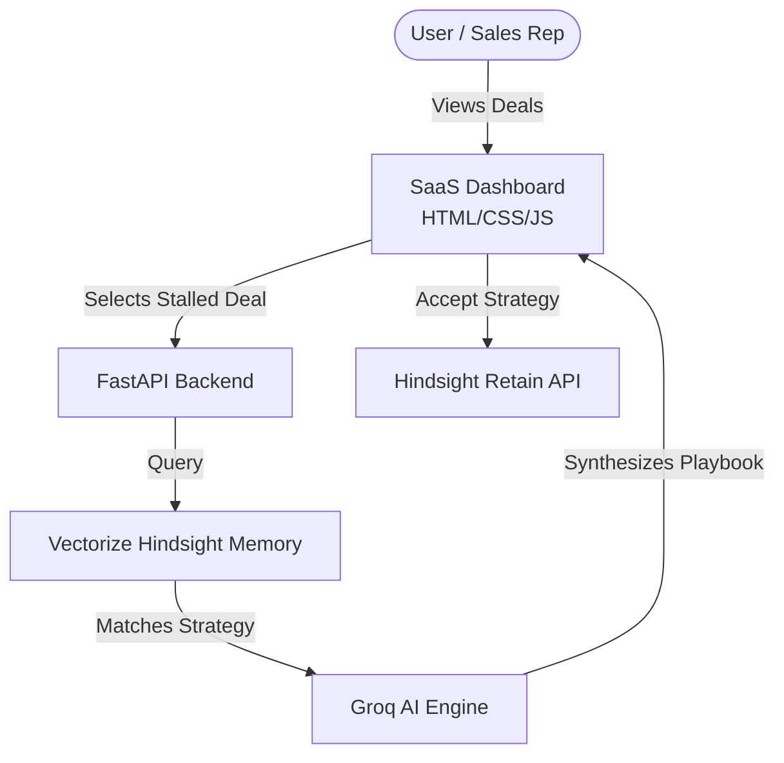

# DealMind - AI Sales Agent with Hindsight Memory

DealMind is an autonomous AI Sales Agent designed to help B2B sales professionals research leads, understand prospects, manage opportunities, and synthesize winning playbooks using the **Vectorize Hindsight Memory Bank**.

## Problem
Sales teams repeatedly face the same objections (e.g., pricing, vendor lock-in, compliance concerns), but their CRM tools forget what worked before. Junior reps start from scratch on every deal, wasting time and losing revenue because institutional knowledge is siloed.

## Solution
DealMind solves this by acting as a living, continuously learning organizational brain. It analyzes stalled pipeline deals and automatically recalls the exact strategies top performers used to win similar deals in the past. 

## Why Hindsight?
Unlike a standard conversational LLM that just gives generic advice, DealMind uses the genuine **Hindsight** architecture to retain and recall successful enterprise strategies. Every deal closed makes the AI smarter for the next one.

## Architecture


## How Hindsight Memory Works
1. **Recall**: When a deal stalls (e.g., "Customer refuses upfront payment"), DealMind queries the Hindsight Memory bank for past deals with similar blockers.
2. **Reason**: The Groq LLM synthesizes the historical memory context with the current deal context to formulate a personalized strategy.
3. **Retain**: If the user accepts the strategy, it is immediately fed back into Hindsight using `api.retain_memories()`. The deal stage updates to 'Strategy Applied', making the company's collective intelligence stronger.

## Demo Flow
1. **Identify the Blocker**: Open *Stark Industries* (Stalled on Net-90 terms).
2. **Consult DealMind**: The AI automatically queries Hindsight and finds the *Oscorp* playbook (milestone-based payments).
3. **Review Recommendation**: The chat visibly highlights the **🧠 HINDSIGHT MEMORY MATCH**.
4. **Save to Hindsight**: Click "🧠 Accept Strategy & Save to Hindsight". The strategy is persisted to Vectorize.
5. **Verify Learning**: Open another deal with a similar blocker and watch the AI recall the newly saved strategy!

## Tech Stack
- **Frontend**: HTML5, CSS3, Vanilla JS, Chart.js
- **Backend**: FastAPI, Uvicorn, Python
- **Database**: SQLite (CRM deals data)
- **AI/Memory**: Vectorize Hindsight Client API, Groq (Qwen/Llama models)

## Installation

1. Clone the repository
2. Install dependencies:
   ```bash
   pip install -r requirements.txt
   ```
3. Set up environment variables (see below).
4. Run the server:
   ```bash
   uvicorn app.main:app
   ```

## Environment Variables
Create a `.env` file in the root directory (do not commit this file to version control). See `.env.example` for details:

```
HINDSIGHT_API_KEY=your_vectorize_key
HINDSIGHT_BASE_URL=https://api.hindsight.vectorize.io
DEALMIND_BANK_ID=dealmind-pro
GROQ_API_KEY=your_groq_key
```

## Hackathon
Built for HackWithHyderabad 3.0.
